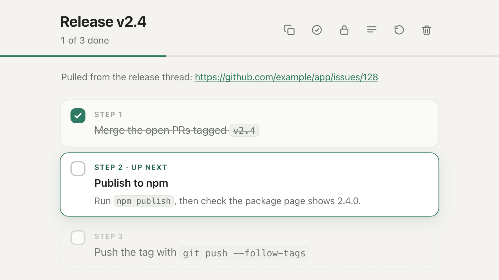

# Listless

Turn a list of tasks into a checklist page that lives only in your browser.

Give an agent a wall of text, let it pull out the tasks, and get back a link to a clean checklist: one checkbox per task. It works at any screen size, prints as a plain list, and follows your system's light or dark setting.

<picture>
  <source media="(prefers-color-scheme: dark)" srcset="docs/preview-dark.png">
  
</picture>

## No off-site storage: everything is local

- Lists, check marks and preferences are stored **only in the browser that opens the link** (`localStorage`).
- Nothing is stored anywhere else: not on the Worker, not in KV, D1, R2 or Durable Objects, not in logs, not in a cache, and not with any third party.
- There are no accounts and no syncing.
- The page's Content-Security-Policy forbids it from making **any** network request, so your browser itself enforces that nothing leaves the page.
- Deleting a list removes it for good once you move on: Delete can be undone right away, until you change something else or leave the page. Clearing this site's data removes every list. Opening the original link again imports a fresh copy.

## How it works

1. An agent builds a link that carries the list after the `#`:

   ```
   https://<host>/l/#v1.<data>
   ```

   `<data>` is `base64url(deflate-raw(JSON))`, and the JSON is a list such as `{"v":1,"title":"…","tasks":["…","…"]}` (see [List format](#list-format)). An agent that can't compress can instead write `https://<host>/l/#json=<percent-encoded JSON>`. Browsers never send the part after `#` to a server.

2. You open the link. The page reads the list from the address, saves it in your browser, and swaps the address for a short one: `https://<host>/l/<id>`. The id is a hash of the list's contents, so opening the same original link again finds the same list and keeps your check marks and any reordering, because the id is fixed when you first open the list. Check marks never affect it. A link can also name the list it updates with an `id` (a share link does), and then it opens that list whatever its contents; a link with no `id` and different contents is a different list. Your saved copy is never changed without you asking: if the link marks tasks done that you haven't checked, the page offers to add them to your check marks, and if the link says something different (an agent edited it), the page offers to use that version, keeping your check marks on the tasks it still has. **Undo** brings the old version back.

3. You check things off. Everything is saved in your browser as you go. Opening `https://<host>/l/` lists every list saved in this browser, with its progress, so you can find one again or delete it.

The page shows progress overall and per section. Tasks in sections that aren't ordered can be reordered within their section by dragging the handle beside them, or with the arrow keys when it's focused. Its toolbar has **Copy as Markdown** (to paste your progress to an agent; it ends with a note on how to answer with an updated link, and a share link, all built in your browser), **Copy share link** (a full link carrying the list as it is now, with its order, check marks and its `id`, so a link an agent edits and hands back updates this list; building it happens in your browser and sends nothing), **Hide completed**, **Hide upcoming** (when anything is ordered), a **Display** button (hover it, or tap it, for **Hide details** and **Hide copy text**), **Uncheck all**, and **Delete**. Those last two, and unchecking an ordered step that has later steps checked, don't use pop-up dialogs: the first click turns the control red with a check mark, and a second click goes ahead (clicking anywhere else, pressing Escape, or waiting a few seconds cancels). Afterwards, an **Undo** button (or Ctrl/⌘+Z) brings the change back until you change something else; a deleted list can be restored the same way. Each titled section has a chevron beside its title that folds it away: Alt-click (⌥-click on a Mac) a chevron to fold or open every section, or Alt-click the last open checkbox in a section to check it off and fold the section in one go (hovering that checkbox says so). Which sections are folded is kept in your browser only: it is never part of a link, a share link or the list's id. Only the checkbox toggles a task, so the text can be selected like any other text. Web addresses in it are links, and clicking a code span or a copy value selects all of it, ready to copy.

## List format

```json
{
  "v": 1,
  "title": "Ship the release",
  "description": "From https://claude.ai/chat/…",
  "ordered": true,
  "sections": [
    { "title": "Prepare", "ordered": true, "tasks": ["Review the PR", { "text": "Bump the version", "details": "Edit `package.json`." }, { "text": "Email Dana the invoice", "copy": "dana@example.com" }] },
    { "title": "Release", "ordered": true, "tasks": ["Merge to `main`", "Run `npm publish`"] }
  ]
}
```

- **`id`**: optional, 12 characters (`A-Z a-z 0-9 - _`). Only a share link has one: it names the saved list the link updates (see [Updating a list](#updating-a-list)). Leave it out of a new list. It isn't content, so it never changes a list's id.
- **`title`**: optional.
- **`description`**: optional. It's shown under the title, which makes it a good place for a link back to the conversation the list came from.
- **`ordered`**: optional. When `true`, things are done in sequence. In a list without sections, only the next unfinished task can be checked off, and the ones after it stay locked. With sections, each section stays locked until every section before it is done. Unchecking a step reopens it and everything after it.
- **`tasks`**: an array of tasks. A task is a string, or `{ "text", "details", "copy", "done" }` when it needs extra explanation, a value to paste elsewhere, or is already complete. Details show in smaller, muted text, and the reader can hide them. `copy` is a value (an email address, an order number, a confirmation code) shown exactly as written in its own box, selected whole with one click, with a copy button beside it; it stays visible when details are hidden. For a step that needs several, make it an array of values, each with its own button, and give an item a short label when they could be confused: `"copy": [{ "label": "Name", "value": "_acme" }, "abc123"]`. Add `"done": true` to a task that is already complete and it starts out checked off (in an ordered list or section, done tasks must come first: see [Ordering](#ordering)).
- **`sections`**: use this instead of `tasks` to group tasks under headings. A section can also set `"ordered": true` to have its own tasks done in sequence (see [Ordering](#ordering)).
- **Text** is plain, with two exceptions: `` `backtick` `` spans show as code, and web addresses (`http://` or `https://`) in task text, details and the description become links. Only the checkbox toggles a task, so clicking text, code or a link never checks it off.

### Ordering

`ordered` works on two levels, and the two settings are independent:

- The list's `ordered` controls the order of the **sections**: each stays locked until every section before it is done.
- A section's `ordered` controls the order of **its tasks**: only the next unfinished one can be checked off.

So a list can mix them. This one lets the gathering happen in any order, keeps `Install` locked until `Gather` is done, and then runs the install steps one by one:

```json
{
  "v": 1,
  "title": "Set up the project",
  "ordered": true,
  "sections": [
    { "title": "Gather", "tasks": ["Find the API key", "Find the deploy token"] },
    { "title": "Install", "ordered": true, "tasks": ["Clone the repo", "Run `npm install`", "Run `npm test`"] }
  ]
}
```

For a single sequence across the whole list, as in the first example, set `ordered` on every section too. A list without sections is one group, so its `ordered` means its tasks are done in sequence. Tasks that start out `done` must fit the ordering: first in an ordered list without sections or in an ordered section, and only in a section whose earlier sections are all done when the list is ordered.

## For agents

`GET /` on any Listless host returns plain-text instructions written for agents. In short, there are three ways to make a link:

**Build it locally (preferred).** Nothing is sent anywhere:

```sh
echo '{"title":"Groceries","tasks":["Milk","Eggs"]}' | node -e 'let s="";process.stdin.on("data",d=>s+=d).on("end",()=>console.log("https://<host>/l/#v1."+require("zlib").deflateRawSync(JSON.stringify({v:1,...JSON.parse(s)})).toString("base64url")))'
```

`GET /` also includes a Python version.

**Or write it by hand, with no code and no network.** For agents that can't run code, put the list as URL-encoded JSON after `#json=`: `https://<host>/l/#json=%7B%22title%22%3A%22Groceries%22%2C%22tasks%22%3A%5B%22Milk%22%2C%22Eggs%22%5D%7D`. The page reads it the same way as a compressed link, including the `id` below. It's longer, so use the other ways when you can.

**Or POST it.** This is the only time the Worker sees the tasks. It compresses them into the link and keeps nothing:

```sh
curl -s -X POST https://<host>/api/lists \
  -H 'content-type: application/json' \
  -d '{"title":"Groceries","tasks":["Milk","Eggs"]}'
# {"url":"https://<host>/l/#v1.…"}
```

Limits:
- Up to 500 tasks in total, and up to 50 sections.
- Task text up to 1,000 characters, details up to 2,000, and a copy value up to 500 (up to 10 per task, labels up to 50).
- List and section titles up to 200 characters.
- Description up to 2,000 characters.
- POST bodies up to 256 KB.

### Updating a list

An agent can't read `/l/<id>`: the list lives in your browser. Instead, give it a share link (**Copy share link**). It decodes the link, adds `"done": true` to the tasks it finished (or edits the list), keeps the `id` as it is, and hands back a new link. Opening that link takes you to the same `/l/<id>` and offers the changes (see [How it works](#how-it-works)). If you paste the list as Markdown instead (**Copy as Markdown**), an agent that can't run code reads the tasks and the `id` from it and writes the new link by hand. Every page also carries a short note for agents that points to `GET /`, and `GET /` has the decode commands and the rules for agents.

```sh
echo '<the share link>' | node -e 'let s="";process.stdin.on("data",d=>s+=d).on("end",()=>console.log(require("zlib").inflateRawSync(Buffer.from(s.trim().split("#v1.")[1],"base64url")).toString()))'
```

## Network traffic, exactly

| Situation | Requests |
|---|---|
| Opening a locally built link | One `GET /l/` for the page, which contains no task data. Nothing after that. |
| Using `POST /api/lists` | One `POST` with the tasks; the response is the link. Nothing is stored or logged. |
| Reopening `/l/<id>` | One `GET` for the page. The list stays in your browser. |
| Opening `/l/` (your lists) | One `GET` for the page. The index is read from your browser's storage. |
| Copy share link | None. The link is built in your browser and copied to the clipboard; opening it somewhere else is the same as opening any other link, and in a browser that already has the list it opens that list. |
| Clicking a link in a list | The linked site opens in a new tab, with no referrer, so it doesn't learn which list you came from. Nothing happens until you click. |

## How to verify

You don't have to take this README's word for it:

1. **View the page source.** The `<meta http-equiv="Content-Security-Policy">` tag includes `default-src 'none'` and `connect-src 'none'`. Together they block every fetch, XHR, WebSocket, beacon, form submission and external resource. It also includes `require-trusted-types-for 'script'`, so the browser refuses to turn a string into HTML or script. The same policy is sent as a response header.
2. **Watch the Network tab** in your browser's developer tools while you open a list and check things off. After the page loads, there are no requests, unless you click a link in the list, which opens in a new tab.
3. **Read the code.** The whole page is [`src/page/`](src/page/), and the Worker is [`src/index.ts`](src/index.ts). The tests check that the policy forbids network access, that its hashes match the page's only inline script and style, and that the Worker has no storage bindings. The browser tests in [`test/page/`](test/page/) drive the page in Chromium and fail on any Content-Security-Policy violation, console error or pop-up dialog.
4. **Know what you can't check.** There is no way to confirm that the hosted Worker is the code in this repository. [The workflow](.github/workflows/deploy.yml) deploys from `master`, and Workers logging is turned off in [`wrangler.jsonc`](wrangler.jsonc), but that is how it's meant to be deployed, not something you can verify: whoever controls the Cloudflare account could deploy different code. Checks 1 and 2 test the page you actually received, but only when you run them, and they can't tell you what the server sends someone else or next time. The Worker's own behavior (the `POST` endpoint and the headers) you have to take on trust.

If that isn't good enough, run it yourself (see below).

## Run it yourself

Requires Node.js 24 or newer.

```sh
npm ci
npm run dev        # http://localhost:8787
```

Under `wrangler dev`, everything stays on your machine. If port 8787 is already in use, Wrangler picks the next free one and prints it.

To deploy to your own Cloudflare account:

[](https://deploy.workers.cloudflare.com/?url=https://github.com/crstauf/listless)

Or run `npx wrangler login && npm run deploy`. No KV namespaces or other resources are needed.

## Development

```sh
npm run build      # rebuild src/page.generated.ts from src/page/
npm run typecheck
npm test           # the Worker: headers, CSP, API
npm run test:page  # the page, driven in Chromium (npx playwright install chromium, once)
```

The page source lives in `src/page/` (`page.html`, `page.css`, `page.js`). `npm run build` inlines the CSS and JS into the HTML, computes the SHA-256 hashes the Content-Security-Policy needs, and writes `src/page.generated.ts`. That file is committed so the deployed page can be reviewed in the repository. CI rebuilds it and fails if it differs. The build also copies the limits from [`src/limits.ts`](src/limits.ts), which the Worker uses too, into the page script before hashing it, so both enforce the same ones.

The browser tests (`npm run test:page`) serve the built page to Chromium with the same Content-Security-Policy header the Worker sends, so they need no server.

After changing how the page looks, run `npm run screenshots` to recapture the README preview (`docs/preview-light.png` and `docs/preview-dark.png`). It needs Playwright's Chromium, which you can install once with `npx playwright install chromium`. No server is needed.

### Deploying from GitHub Actions

Two workflows live in `.github/workflows/`. `check.yml` runs the checks (the generated page is up to date, typecheck, the Worker tests and the browser tests) on every pull request and has no access to secrets. `deploy.yml` runs on pushes to `master`: it calls `check.yml` first, then deploys. The deploy needs two repository (or `production` environment) secrets:

- `CLOUDFLARE_API_TOKEN`: an API token with the **Workers Scripts: Edit** permission
- `CLOUDFLARE_ACCOUNT_ID`

[Dependabot](.github/dependabot.yml) opens a weekly pull request for updates to the Actions and the npm dependencies; the same checks run on it.

## License

[MIT](LICENSE)
